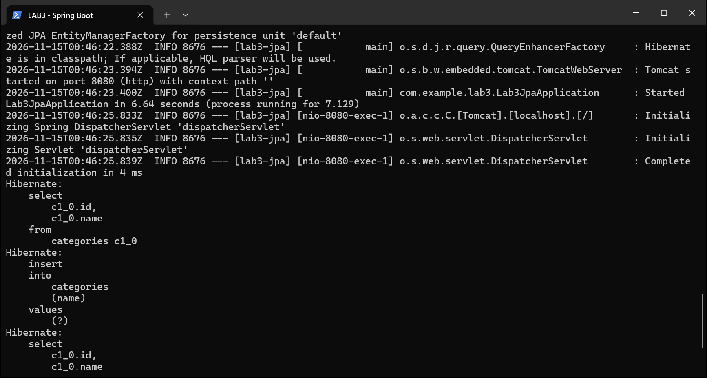
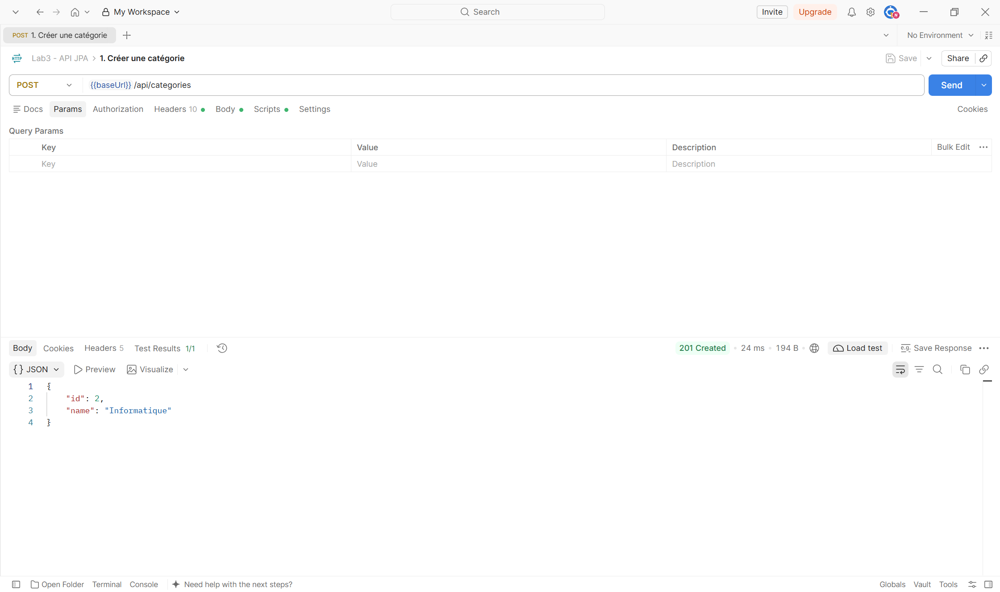
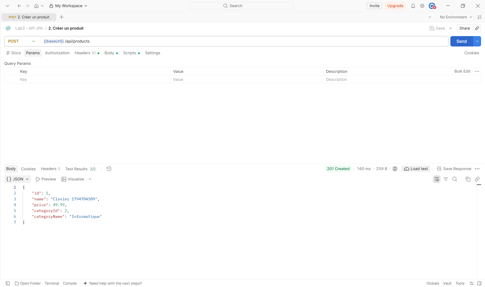
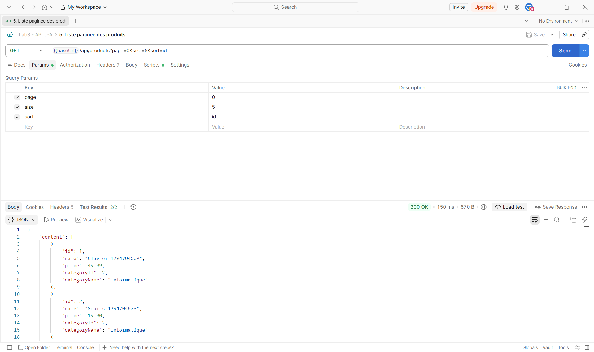
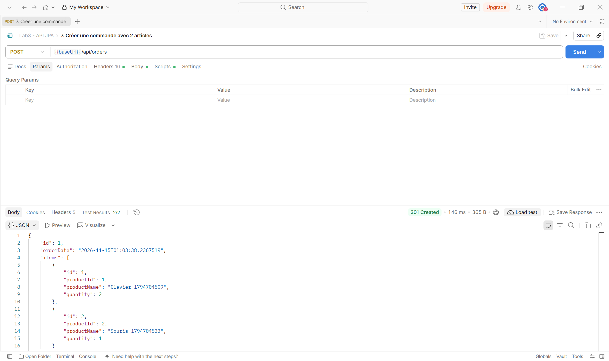
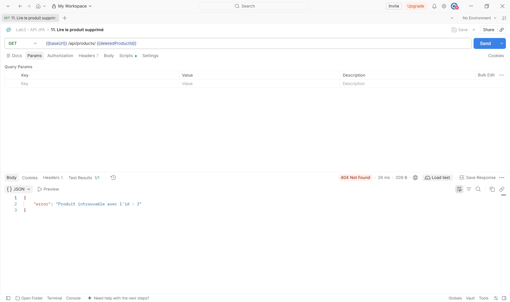
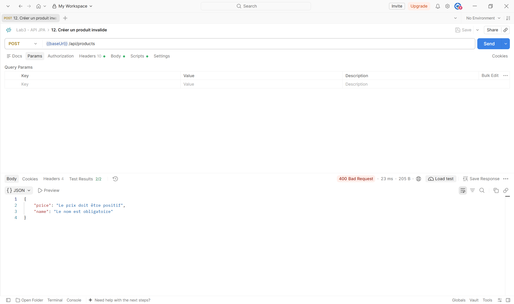
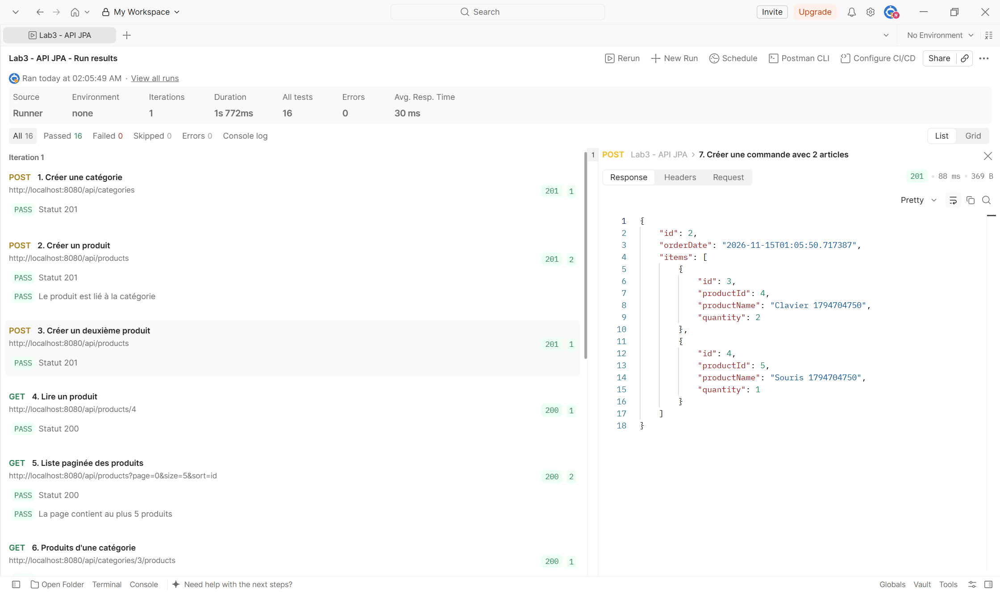
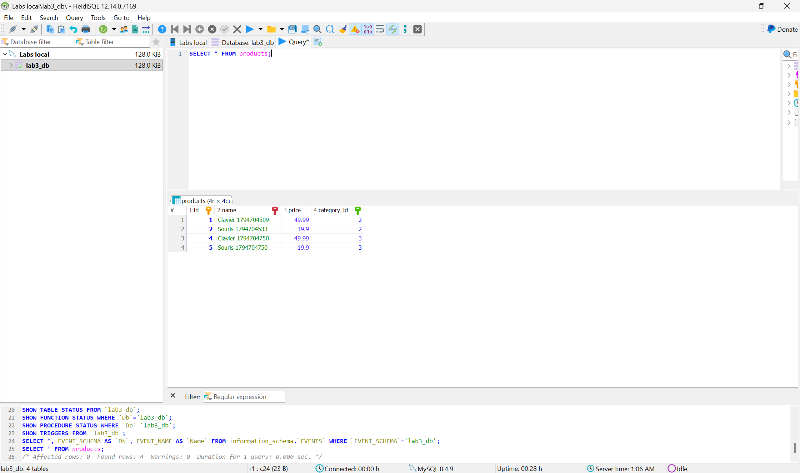
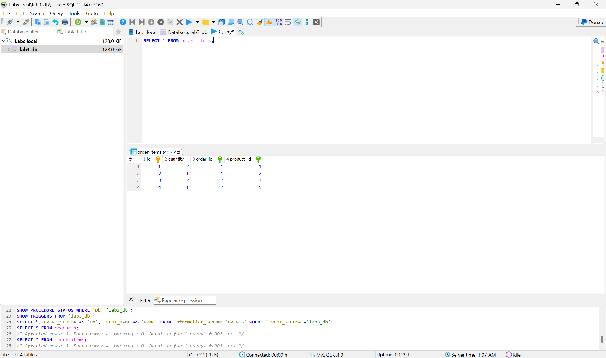

# LAB 3 : Persistance avec Spring Data JPA et MySQL

API REST de gestion de produits, catégories et commandes, avec les données enregistrées dans MySQL.

## Prérequis

- JDK 21
- MySQL Server 8 et MySQL Workbench
- Maven (ou le wrapper `./mvnw` fourni)

## Base de données

1. Dans MySQL Workbench, exécuter `src/main/resources/db/create_database.sql` :

```sql
CREATE DATABASE lab3_db CHARACTER SET utf8mb4 COLLATE utf8mb4_unicode_ci;
```

2. Vérifier les identifiants dans `src/main/resources/application.properties` (`root` / `root` par défaut).

Les tables sont créées par Hibernate au démarrage (`ddl-auto=update`).

## Lancer le projet

```bash
./mvnw spring-boot:run
```

L'API est disponible sur `http://localhost:8080`.

Pour avoir des données d'exemple, exécuter ensuite `src/main/resources/db/insert_data.sql` dans Workbench, une seule fois, sur une base vide. Le script n'est pas chargé automatiquement : avec `ddl-auto=update`, il serait relancé à chaque démarrage et échouerait sur le nom unique des produits.

## Modèle

| Table | Relation |
|-------|----------|
| `categories` | Une catégorie a plusieurs produits |
| `products` | Un produit appartient à une catégorie (`category_id`) |
| `orders` | Une commande a plusieurs articles |
| `order_items` | Un article référence un produit (`product_id`) et une commande (`order_id`) |

La table s'appelle `orders` car `ORDER` est un mot réservé en SQL.

Les contrôleurs renvoient des DTO et non des entités. Il n'y a donc pas de boucle JSON entre `Category` et `Product`. Les annotations `@JsonManagedReference` et `@JsonBackReference` sont tout de même présentes : si une entité était renvoyée directement, elles couperaient la boucle en ignorant le côté enfant.

La conversion en DTO se fait dans les méthodes `@Transactional` des services, pour que les relations `LAZY` puissent encore être chargées (sinon `LazyInitializationException`).

## Endpoints

| Méthode | URL | Statut attendu |
|---------|-----|----------------|
| POST | `/api/categories` | 201, 400 |
| GET | `/api/categories` | 200 |
| GET | `/api/categories/{id}` | 200, 404 |
| GET | `/api/categories/{id}/products` | 200, 404 |
| POST | `/api/products` | 201, 400, 409 si le nom existe déjà |
| GET | `/api/products?page=0&size=10&sort=id` | 200 |
| GET | `/api/products/search?name=` | 200 |
| GET | `/api/products/{id}` | 200, 404 |
| PUT | `/api/products/{id}` | 200, 400, 404 |
| DELETE | `/api/products/{id}` | 204, 404, 409 si le produit est dans une commande |
| POST | `/api/orders` | 201, 400, 404 si un produit n'existe pas |
| GET | `/api/orders/{id}` | 200, 404 |

Exemple de création de commande :

```json
{ "items": [ { "productId": 1, "quantity": 2 }, { "productId": 3, "quantity": 1 } ] }
```

## Tests avec Postman

1. Cliquer sur **Import** et sélectionner `postman/Lab3-API.postman_collection.json`.
2. Lancer la collection avec **Run collection**, l'application étant démarrée.

Après chaque écriture, vérifier dans Workbench que les données sont bien enregistrées :

```sql
SELECT * FROM categories;
SELECT * FROM products;
SELECT * FROM orders;
SELECT * FROM order_items;
```

## Exécution

Captures réalisées en lançant le projet en local (MySQL 8.4, port 3306).

**Démarrage de l'application** : Spring Boot se connecte à `lab3_db` et démarre sur le port 8080.



**Création d'une catégorie** : `POST /api/categories` renvoie 201 avec l'identifiant généré.



**Création d'un produit** : `POST /api/products` renvoie 201, le produit est lié à sa catégorie.



**Liste paginée** : `GET /api/products?page=0&size=5&sort=id` renvoie une page avec `content`, `totalElements` et `totalPages`.



**Création d'une commande** : `POST /api/orders` enregistre la commande et ses 2 articles dans la même transaction.



**Produit supprimé** : après `DELETE`, `GET /api/products/{id}` renvoie 404 avec un message clair.



**Produit invalide** : un nom vide et un prix négatif sont refusés avec 400 et un message par champ.



**Collection complète** : les 12 requêtes passent dans le Collection Runner, avec 16 tests réussis sur 16.



**Données en base** : les produits et les articles de commande sont bien enregistrés dans MySQL.




